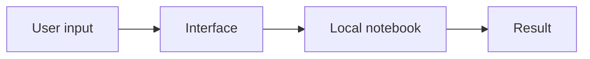
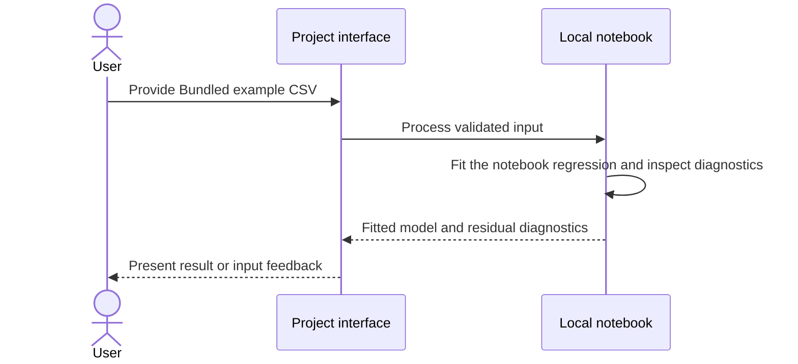
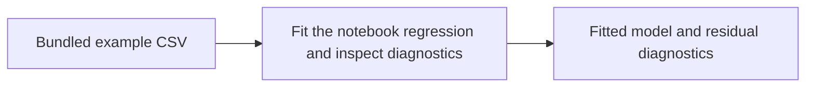

# Linear Regression Assumptions

## 1. Project overview

A python code snippet to test assumptions of linear regression. This repository is a fork of [campusx-official/linear-regression-assumptions](https://github.com/campusx-official/linear-regression-assumptions).

[Source repository](https://github.com/subhashdixit/linear-regression-assumptions)

## 2. Motivation and problem statement

### Objective

Run the upstream notebook that examines assumptions of a linear regression model.

### Problem statement

A fitted line alone gives little information about whether residual behavior supports an interpretation.

### Motivation

Diagnostic plots help identify when model assumptions deserve a closer look.

## 3. Solution and scope

**Inputs** — Bundled example CSV. **Outputs** — Fitted model and residual diagnostics.

The checked-in example follows the upstream project. It is included here as a runnable reference. [Upstream source](https://github.com/campusx-official/linear-regression-assumptions)

## 4. Quick start and usage

Start with the documented sample or supported input. Review the output and any validation feedback. Use the local setup below.

## 5. High-level architecture

## 6. End-to-end request workflow

## 7. Data sources, inputs, and outputs

| Input | Processing | Output |
| --- | --- | --- |
| Bundled example CSV | Fit the notebook regression and inspect diagnostics | Fitted model and residual diagnostics |

## 8. Data flow and ETL pipeline

## 9. Low-level design and interfaces

Open [`linear-regression-assumptions.ipynb`](<linear-regression-assumptions.ipynb>) to inspect the sequence of cells and the data contract.

## 10. Concepts and algorithms

- **Ordinary least squares**. Fit a linear relationship by minimizing squared residuals.
- **Residual diagnostics**. Inspect model errors for pattern, spread and distribution before interpreting the fit.

## 11. Technology choices and dependencies

- **Python and Jupyter**. Run and inspect the original exercise one cell at a time.

## 12. Training, inference, and evaluation

Review behavior using the checked-in fixtures and assertions. This application has no project-trained model benchmark.

## 13. Limitations and data handling

Use the project within the scope of its documented inputs, datasets, and evaluation.

## 14. Installation and local setup

Clone [this fork](https://github.com/subhashdixit/linear-regression-assumptions) and start a Python environment with Jupyter. Open the notebook listed above. Install the dependencies referenced by its imports before running cells.

## 15. Repository structure

- [`data.csv`](<data.csv>)
- [`linear-regression-assumptions.ipynb`](<linear-regression-assumptions.ipynb>)

## 16. Deployment and operations

Run the exercise locally. The repository does not document a maintained deployment.

## 17. License, credits, and support

The repository does not contain a root LICENSE file. Check upstream and data-source terms before reuse. Original project attribution is recorded at [campusx-official/linear-regression-assumptions](https://github.com/campusx-official/linear-regression-assumptions).
